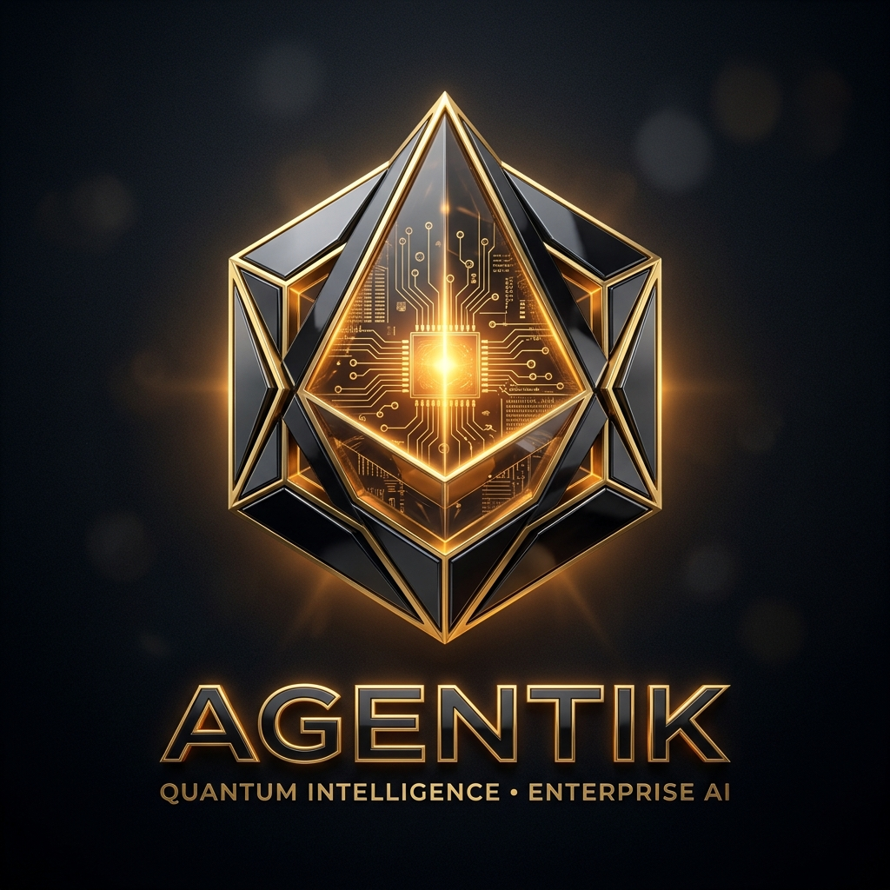

# Hi there, we are Agentik 👋 🇮🇩

<p align="center">
  
</p>

<p align="center">
  <a href="https://agentik.my.id"></a>
  <a href="https://agentik.my.id"></a>
  <a href="https://agentik.my.id"></a>
  <a href="https://agentik.my.id"></a>
</p>

---

### 🚀 Tentang Agentik
**[Agentik.my.id](https://agentik.my.id)** adalah infrastruktur AI API Gateway & Multi-Model Proxy pertama di Indonesia yang dirancang khusus untuk membebaskan developer, researcher, dan tech builder dari hambatan pembayaran kartu kredit luar negeri.

Kami menyediakan satu gerbang terpadu untuk mengakses model-model AI terbaik di dunia (**Claude 4.6 Sonnet, Claude 4.6 Opus Thinking, Gemini 3.8 Flash, GPT-OSS 120B**) dengan sistem saldo fleksibel *Pay-As-You-Go* berbasis pembayaran instan **QRIS**.

---

### 🌟 Repositori Unggulan & Ekosistem Riset

| Repositori | Kategori | Deskripsi | Tautan |
| :--- | :--- | :--- | :--- |
| 🏛️ **Financial AI Agent Architectures** | *Quantitative & Finance* | Cetak biru 12 bab arsitektur AI agent Wall Street, simulasi debat trading Bull vs Bear, dan Agentic RAG keuangan. | [Lihat Repo ➔](https://github.com/agentikmyid/financial-ai-agent-architectures) |
| ⚡ **Cara Pakai Claude di Cursor Tanpa Kartu Kredit** | *Developer Tools* | Panduan integrasi AI coding assistant terpopuler (Cursor, Cline, VS Code) menggunakan saldo QRIS lokal. | [Lihat Repo ➔](https://github.com/agentikmyid/cara-pakai-claude-cursor-tanpa-kartu-kredit) |

---

### ✨ Kenapa Builder Indonesia Memilih Agentik?

| Fitur | Provider AI Luar Negeri | Agentik.my.id |
| :--- | :--- | :--- |
| **Metode Pembayaran** | Kartu Kredit USD (Sering Ditolak 3D-Secure) | **QRIS Sat-Set (GoPay, DANA, BCA, Livin, OVO)** |
| **Model Tersedia** | Terkunci 1 Ekosistem | **Multi-Model: Claude 4.6, Gemini 3.8, GPT-OSS** |
| **Komitmen Biaya** | Langganan flat $20/bln | **Pay-As-You-Go (Mulai Rp10.000)** |
| **Kompatibilitas** | Format API Berbeda-beda | **100% OpenAI Standard (`/v1/chat/completions`)** |
| **Routing & Latensi** | Server Global Jauh | **Jalur Cepat Optimasi Asia Tenggara** |

---

### 🛠️ Didukung Penuh di Berbagai AI Tools & IDE

Agentik dapat langsung digunakan tanpa mengubah workflow kerja Anda:
- **Coding IDEs:** Cursor, Windsurf, VS Code (Cline, Roo Code, Continue.dev).
- **Framework AI:** LangChain, LlamaIndex, AutoGen, CrewAI.
- **Autonomous Runtimes:** Claude Code, OpenCode, Hermes Agent.
- **SDKs:** Python `openai`, Node.js / TypeScript `openai`.

---

### ⚡ Quickstart (Python)

```python
from openai import OpenAI

# Gunakan base_url Agentik & API Key dari dashboard
client = OpenAI(
    base_url="https://api.agentik.my.id/v1",
    api_key="agtk_live_your_api_key_here"
)

response = client.chat.completions.create(
    model="claude-sonnet-4-6",
    messages=[
        {"role": "system", "content": "Kamu adalah AI asisten pintar."},
        {"role": "user", "content": "Jelaskan cara kerja autonomous agent secara singkat!"}
    ]
)

print(response.choices[0].message.content)
```

---

### 🌐 Hubungi & Kunjungi Kami
- 🔗 **Website Resmi:** [https://agentik.my.id](https://agentik.my.id)
- 📖 **Dokumentasi Lengkap:** [financial-ai-agent-architectures](https://github.com/agentikmyid/financial-ai-agent-architectures)
- 💬 **Support Developer:** Bantuan teknis & kemitraan via dashboard resmi.

<p align="center">
  <i>Dibuat dengan ❤️ di Indonesia untuk kemajuan ekosistem AI Tanah Air.</i>
</p>
